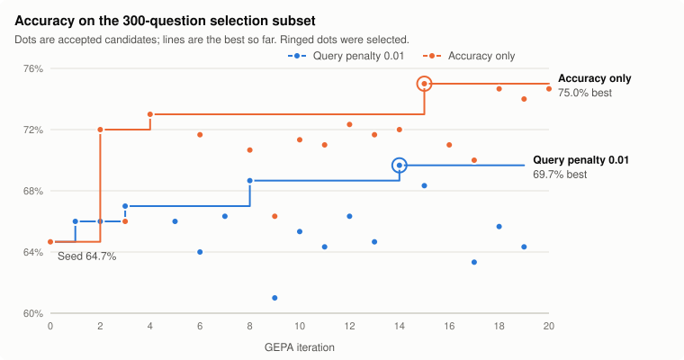

# BIRD SQL with DSPy Flex + GEPA

Can a text-to-SQL system get better without touching model weights, just by
letting an LLM rewrite the program around the model?

This project tests that on [BIRD](https://bird-bench.github.io/). The solver is
a plain Python class. [DSPy Flex](https://dspy.ai/current/api/modules/Flex/) runs
its source in a sandbox, and [GEPA](https://dspy.ai/current/api/optimizers/GEPA/overview/)
rewrites that source (helpers, prompts and control flow) from execution
feedback. By default, model calls go through your ChatGPT Codex login, so no API
key is needed. [Other models](#other-models) work too.

On the 1,376-question validation split, a run went from **61.2% to 73.6%**
execution accuracy. See [Results](#results) for what that number does and does
not show.

## The problem

Text-to-SQL turns a natural-language question about a database into a SQL query.
BIRD questions come with a database and an optional *evidence* hint, which is
external knowledge written by the annotators:

```text
Database:  retail_complains
Question:  On which day was the most verbose complaint received?
Evidence:  day received refers to "Date received";
           most verbose complaint refers to MAX(ser_time);
Reference: SELECT `Date received` FROM callcenterlogs
           WHERE ser_time = (SELECT MAX(ser_time) FROM callcenterlogs)
```

An answer counts as correct when its SQL executes and returns the same rows as
the reference SQL. That is *execution accuracy* (EX). The SQL text itself does
not have to match.

BIRD is hard because its databases are real and messy: large schemas,
inconsistently named columns, dirty values, and questions whose meaning depends
on the evidence. A good solver has to inspect the schema, ground literal values,
choose the right grain of aggregation, and return exactly the requested columns.

Here the language models are fixed. The thing being optimized is the **program**:
how the solver inspects the database, what it asks the model, and when it
checks or repairs its own SQL.

## DSPy in brief

You don't need to know [DSPy](https://dspy.ai/) to follow this README, but a
few of its terms come up throughout.

- **Language model.** Two are used. The *task model* answers questions inside
  the solver. The *reflection model* reads the results and rewrites the solver.
- **Signature.** The inputs and outputs of one model call, written as a string
  such as `"question, evidence, schema_text -> sql"`, plus optional
  instructions. DSPy builds the prompt from it.
- **Predictor.** An object that calls the model for a signature.
  `dspy.Predict` asks for the outputs directly, and `dspy.ChainOfThought` asks
  for step-by-step reasoning first. `dspy.ReAct` is an agent: it can call tools
  such as `query_database` over several steps before it answers.
- **Module.** A class built from predictors and plain Python, much like a
  PyTorch module. Its `forward` method takes the inputs and returns a
  `dspy.Prediction`, an object holding the outputs as attributes, such as
  `prediction.sql`.
- **Adapter.** Turns a signature and its inputs into prompt messages, and
  parses the reply back into fields. This project uses DSPy's JSON adapter,
  which asks the model to reply with a JSON object.
- **Flex.** A module whose code is Python source held as a string, not a class
  in your program. It runs that source in a sandbox: Pyodide, a WebAssembly
  build of Python, running under Deno. Calls to predictors and tools are
  passed back to the host, the Python process that runs the CLI.
- **Tool.** A host function that the sandboxed code may call. Here the only
  one is `query_database`.
- **Metric.** A function that scores one prediction against the reference
  answer. A *metric call* is one solver run on one question, plus its score.
- **GEPA.** An optimizer, available in DSPy as `dspy.GEPA`. It doesn't tune
  weights. It shows the reflection model the metric's scores and written
  feedback, and asks for a better program. With Flex, it rewrites the
  solver's whole source.

## Data

| Set | Source | Questions | Databases | Used for |
| --- | --- | ---: | ---: | --- |
| Training | [BIRD23 train-filtered](https://huggingface.co/datasets/birdsql/bird23-train-filtered) | 5,221 | 54 | Execution traces and feedback for GEPA's reflection |
| Validation | BIRD23 train-filtered | 1,376 | 15 | Selecting candidates, and before/after evaluation |
| Test | [BIRD mini-dev](https://github.com/bird-bench/mini_dev) (SQLite) | 500 | 11 | Held out. Never loaded by optimization |

The 6,601 train-filtered questions are split **by database**, so validation
databases never appear in training. With seed 42, whole databases go to
validation until the split is as close as possible to 20%. Two duplicate
questions are removed, and two training questions whose reference SQL fails are
left out. The test set comes from a separate dataset, with 11 different
databases.

Validation covers 15 databases, from `mondial_geo` (211 questions) and
`simpson_episodes` (164) down to `shooting` (16). Most questions (86%) have
evidence. Mini-dev questions are labelled simple, moderate or challenging.
Train-filtered questions are not.

Preparation runs every reference query once and stores its complete result rows.
The solver sees only `db_id`, `question` and `evidence`. The reference SQL and
answer rows are labels: they are used for grading and for feedback to the
optimizer, never as solver input.

The download is about 9.7 GB, and the extracted databases take about 34 GB.
See [Data preparation](docs/DATA_PREPARATION.md) for sources, cleaning and
outputs. The datasets are CC BY-SA 4.0.

## Method

### The seed solver

[seed.py](bird_gepa/seed.py) is the starting point. For each question it:

1. Lists the database's tables.
2. Fetches their `CREATE TABLE` definitions.
3. Drafts SQL with a `ChainOfThought` predictor.
4. Runs the draft and collects a 20-row preview or the error.
5. Asks a second predictor to review the draft against the question, evidence,
   schema and preview, and returns the revised SQL.

That is three database queries and two model calls per question.

### What GEPA can change

The whole `SQLSolver` class is editable: prompts, helper methods, branching, the
number of model calls, and which DSPy modules it uses (`ReAct`, for example).
Flex runs the source in a Deno/Pyodide sandbox and allows at most ten predictor
calls per question.

Some things stay outside the editable source. The solver reaches the data only
through one host tool:

```python
query_database(db_id, sql, parameters=None, row_limit=20)
```

The tool enforces read-only access, a five-second deadline per query and at most
200 rows. It counts every call, and it never sees reference answers.

### The metric

[metric.py](bird_gepa/metric.py) executes the returned SQL and compares its
complete result with the reference, as an unordered set of rows. Row order and
duplicate rows are ignored. This follows the idea of BIRD's EX, but it is not
the official evaluation script, so scores are not leaderboard numbers.

Wrong answers score 0. By default, correct answers lose 0.01 for each database
query after the first, so the seed's three queries score 0.98.
`--query-penalty 0` makes the score plain accuracy.

The score also comes with written feedback for GEPA: the final SQL, row counts,
the query trace and, for wrong answers, the reference SQL plus sample missing
and unexpected rows.

### The search

[GEPA](https://github.com/gepa-ai/gepa) is an evolutionary search guided by an
LLM. Each iteration:

1. Picks a parent from the **Pareto frontier**: candidates that are best on at
   least one validation question stay in play, even when their average is lower.
2. Runs the parent on **eight training questions** and collects scores, traces
   and feedback.
3. Asks the reflection model to propose new solver source.
4. Runs the proposal on the same eight questions. If its total improves, scores
   it on a fixed **300-question validation subset**.

The subset is drawn once, in proportion to each database's share of the
validation split. The search stops when the **5,500 metric-call budget** runs
out. Each accepted proposal costs 8 + 8 + 300 calls, so most of the budget goes
to validation. GEPA returns the best candidate on the subset, and the CLI scores
it again on all 1,376 validation questions.

| Setting | Option | Default |
| --- | --- | --- |
| Task model (runs the solver) | `--task-model` | `codex/gpt-6-luna` |
| Reflection model (rewrites the source) | `--reflection-model` | `codex/gpt-6-astra` |
| Metric-call budget | `--metric-calls` | 5,500 |
| Training questions per reflection | `--reflection-minibatch-size` | 8 |
| Validation subset for selection | `--validation-size` | 300 of 1,376 |
| Predictor calls per question | `--max-predictor-calls` | at most 10 |
| Query penalty | `--query-penalty` | 0.01 per query after the first |
| Workers | `--num-threads` | 8 |
| Seed | `--seed` | 42 |

## Running it

You will need:

- Python 3.12 and [uv](https://docs.astral.sh/uv/)
- [Deno](https://deno.com/), for the Flex sandbox
- Bash, jq and unzip, for downloading data
- A ChatGPT Codex login (`codex login`), or an API key for [another model](#other-models)
- About 50 GB of free disk space

```bash
uv sync
bash scripts/download_bird.sh
uv run python -m bird_gepa.prepare
uv run python -m bird_gepa.cli --output artifacts/bird-solver/solver.json
```

The CLI evaluates the seed on the full validation split, runs GEPA, evaluates
the selected solver on the full split again, and saves it to `--output` in
DSPy's JSON format. The output directory also holds the model cache and the checkpoint.
Rerun the same command to resume. A resume with different settings is refused,
so use a new output directory for each experiment.

```bash
uv run python -m bird_gepa.cli --help
```

Some timings, from runs on Codex:

- One full validation pass of the seed takes about 18 minutes with 12 workers.
- A complete default run (two full passes and 5,500 metric calls with 8
  workers) took about 4–5 hours.
- With 16 workers, the Codex backend started rate limiting. Eight workers was
  reliable. Twelve worked for a single evaluation pass.

`--skip-baseline` skips the first full pass. The final pass always runs.

### Other models

Model names that start with `codex/` use your Codex login. Any other name is
passed to [LiteLLM](https://docs.litellm.ai/docs/providers) through `dspy.LM`,
which reads the provider's API key from the environment:

```bash
export OPENAI_API_KEY=...
uv run python -m bird_gepa.cli \
    --task-model openai/gpt-5-mini \
    --reflection-model openai/gpt-5 \
    --output artifacts/openai/solver.json
```

The same works for `anthropic/...`, `gemini/...`, or a local model such as
`ollama_chat/...`. A default run makes about 8,000 solver runs with at least
two model calls each, so on a paid API try a short run first, such as
`--metric-calls 500 --validation-size 50 --skip-baseline`. The final pass
still scores all 1,376 validation questions. Lower `--num-threads` if the
provider rate limits.

### Using the optimized solver

`load_solver` restores a saved solver with its database tool and a task model:

```python
from bird_gepa import load_solver
from bird_gepa.codex import CodexLM

solver = load_solver(
    "artifacts/bird-solver/solver.json",
    databases="data/bird/databases",
    lm=CodexLM("codex/gpt-6-luna"),
)
prediction = solver(
    db_id="retail_complains",
    question="On which day was the most verbose complaint received?",
    evidence="most verbose complaint refers to MAX(ser_time);",
)
print(prediction.sql)
print(prediction.query_trace.count)  # database queries the solver made
```

`databases` is a directory of `<db_id>/<db_id>.sqlite` files, so the solver can
answer questions about any database in it, including the mini-dev test
databases. Any DSPy language model works in place of `CodexLM`.
The solver runs in the Flex sandbox, so Deno is required. It formats prompts
with the same JSON adapter, and applies the same query limits, as during
optimization. The project is not an installable package, so run this from the
repository root.

The file stores the solver source as `module_src`, next to DSPy's version
metadata, and no model or credentials. To read the source:

```bash
jq -r .module_src artifacts/bird-solver/solver.json
```

## Results

All numbers are execution accuracy on the 1,376 validation questions, from
single runs on Codex Luna (solver) and Astra (reflection).

### Accuracy-only versus query-penalised search

Two runs used the default settings above. The only difference was the query
penalty.

| | Query penalty 0.01 | Accuracy only (penalty 0) |
| --- | ---: | ---: |
| Seed accuracy | 62.21% (856) | 61.19% (842) |
| Optimized accuracy | 67.44% (928) | **73.55% (1,012)** |
| Gain | +5.23 points | **+12.35 points** |
| Queries per question, seed → optimized | 4.00 → 1.11 | 4.00 → 2.45 |
| GEPA iterations | 19 | 20 |
| Candidates accepted | 17 | 17 |
| Best accuracy on the 300-question subset | 69.67% | 75.00% |
| GEPA metric calls | 5,688 | 5,712 |

These runs used an earlier seed that re-ran its final SQL before returning it,
so it made four queries per question. The current [seed.py](bird_gepa/seed.py)
drops that query. GEPA checks the budget only between iterations, so both runs
went slightly over 5,500 metric calls.

### Progress over the search

<picture>
  <source media="(prefers-color-scheme: dark)" srcset="docs/images/gepa-progress-dark.svg">
  
</picture>

Each dot is a candidate that beat its parent on eight training questions and
was then scored on the 300-question selection subset. The line is the best
subset accuracy so far, and the ringed dot is the candidate GEPA returned. Both
runs start from the same seed, at 64.7% on the subset.

- **Accuracy only** made most of its progress early, and every candidate it
  accepted beat the seed. Its first candidates replaced the whole workflow
  with a single `ReAct` agent and reached 72–73% by iteration 4, but that line
  never went higher.
- **With the penalty**, proposals were accepted on the penalised score, so a
  candidate that only dropped queries could pass while staying close to the
  seed on accuracy. Five of the seventeen fell below it. The best reached
  69.7% at iteration 14.

The accuracy-only winner shows why GEPA keeps a Pareto frontier rather than
only the leader. A draft-then-review candidate from iteration 3 scored just 66%
on the subset, but it answered seven questions that both single-agent leaders
missed, so it stayed eligible as a parent. At iteration 12 its child turned the
reviewer into a `ReAct` agent (72.3%), and at iteration 15 the next generation
reached 75.0%, the best of the run.

On the full validation split the winners scored 73.55% and 67.44%, below
their 75.0% and 69.7% on the subset they were selected on. Both searches
spent about 95% of their metric calls scoring candidates on the subset.

### What the search found

Both winners kept the seed's overall shape: fetch the schema, then generate
SQL. Both merged the two schema queries into one, and both turned a plain
prompt into a long list of SQL rules learned from feedback. Examples include
how to choose `COUNT(*)` versus `COUNT(DISTINCT key)`, keeping the full
population in percentage denominators, `ORDER BY ... LIMIT 1` for a singular
"which has the most", and matching evidence labels case-insensitively.

- With the penalty, the optimizer learned that queries cost points. Its winner
  writes SQL in one `ReAct` step that is told not to re-read the schema, and it
  checks values only when unsure. Queries fell 72%, but accuracy gained only 5
  points.
- Without the penalty, the winner keeps a draft-then-review structure. It turns
  the reviewer into a `ReAct` agent that executes the draft, inspects stored
  values and validates any change before returning it. It made more queries
  and gained more than twice as much accuracy.

On this budget, the penalty traded about 6 points of accuracy for about 1.3
fewer queries per question.

The complete source changes of both winners are in
[experiments/](experiments/README.md#source-changes).

### How to read these numbers

- **They are validation scores, not test scores.** The selection subset is part
  of the final evaluation, and candidates were chosen to score well on it.
  The 500 mini-dev test questions have not been evaluated. Expect a held-out
  score to be somewhat lower.
- **Each setting ran once.** The seed itself scored 62.21% and 61.19% under
  identical settings with a shared response cache, so differences of about a
  point are within run-to-run variation. The 12-point gain is well outside it.
  The 6-point gap between objectives is suggestive, not established.
- **Some learned rules are very specific**, such as one about
  "user-to-compliment associations". They came from individual training
  questions and may not transfer to unseen databases.
- **ReAct escapes the call cap.** The ten-call limit counts top-level predictor
  calls, not the steps inside a `ReAct` agent. Query counts are measured, but
  model cost is not scored.
- **The metric is not the official BIRD evaluator**, and the data is a
  train-filtered split, not BIRD dev. These scores are not comparable with the
  leaderboard.

The run reports, logs, candidates and optimized solvers for both runs are in
[experiments/](experiments/).

## Layout

```text
bird_gepa/
├── seed.py          # The editable SQLSolver class that GEPA rewrites
├── database.py      # Read-only SQLite access and the query_database host tool
├── program.py       # The Flex program, query tracing, and load_solver
├── metric.py        # Execution accuracy, query penalty and feedback
├── optimization.py  # GEPA search, checkpoints and before/after evaluation
├── data.py          # Prepared splits and DSPy examples
├── codex.py         # A DSPy LM that sends requests with your Codex login
├── cli.py           # python -m bird_gepa.cli
└── prepare.py       # python -m bird_gepa.prepare
experiments/         # Logs, candidates and solvers from the two reported runs
scripts/
└── download_bird.sh # Download questions and databases
tests/
```

Start with [seed.py](bird_gepa/seed.py), then [program.py](bird_gepa/program.py) and
[optimization.py](bird_gepa/optimization.py).

## Documentation

- [Data preparation](docs/DATA_PREPARATION.md): how the questions are cleaned and
  split, and how reference answers are stored.
- [Architecture](docs/ARCHITECTURE.md): the sandbox, the database boundary, metric
  feedback, the selection subset, the Codex model and checkpoints.

## Development

```bash
uv run pytest -q
uv run pytest -q -m "not slow"  # skip the end-to-end Flex and GEPA runs
uv run ruff check .
uv run ruff format --check .
uv run mypy
```

Tests marked `slow` run real Flex and GEPA in the Deno sandbox against a mocked
Codex endpoint. They are skipped without Deno.
